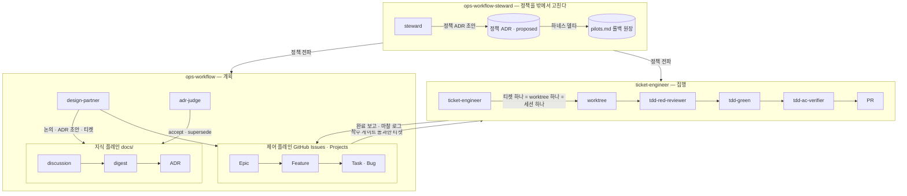

# jyoliar-lab

개인 홈랩과 사이드 프로젝트를 AI agent와 함께 운영하기 위해, **운영 프로세스 자체를 설계하고 돌리는** 조직이다.
agent에게 일을 맡기는 것이 아니라, agent가 틀리기 쉬운 자리마다 구조를 세우고 그 구조 안에서 agent가 일하게 한다.
2026년 7월부터 홈랩 Kubernetes와 서비스 몇 개가 이 프로세스 위에서 운영되고 있다.
결정은 전부 [ADR](https://github.com/jyoliar-lab/ops-workflow/tree/main/docs)로, 작업은 전부 [티켓](https://github.com/jyoliar-lab/ops-workflow/issues)으로 남아 있다.

## 겪은 문제와 설계 응답

| 겪은 문제 | 설계 응답 |
|---|---|
| 코드에는 "무엇"만 있고 "왜"가 없다. agent는 과거 결정의 이유를 모른 채 같은 논의를 반복한다 | 작업 추적과 결정 기록을 두 플레인으로 가른다. 작업은 GitHub Issues에, 결정의 "왜"는 ADR에 — [ADR-0001](https://github.com/jyoliar-lab/ops-workflow/blob/main/docs/ops-workflow/adr/adr-0001-two-plane-control-knowledge.md) |
| agent의 미검증 추정이 문서에 들어가면 다음 세션이 그것을 사실로 읽는다 | 지식 쓰기 · ADR accept · 티켓 close를 사람 승인 뒤에 둔다. 초안을 벌리는 agent와 심사하는 agent를 가른다 |
| "하지 마세요"는 지켜지지 않는다. 프롬프트의 금지는 긴 세션에서 잊힌다 | 금지를 프롬프트가 아니라 hook · exit 코드 · RBAC로 건다. 막히면 거부 사유가 대안을 말한다 |
| agent가 코드와 테스트를 같이 쓰면 사람이 둘 다 읽어야 하고, 검수가 병목이 된다 | 시나리오 승인 → red → 검토 → green → 검증을 서로 다른 subagent가 맡는 TDD 파이프라인. 사람은 코드가 아니라 시나리오와 대조표를 본다 |
| 프로세스 규칙이 하네스 여기저기에 흩어져 낡는다 | 프로세스 정책도 ADR로 적고, 정책이 하네스에 반영됐는지 감사하는 별도 agent를 둔다 — [ADR-0032](https://github.com/jyoliar-lab/ops-workflow/blob/main/docs/ops-workflow/adr/adr-0032-policy-adr-defers-accept.md) |
| 한 세션에 계획과 집행이 섞이면 컨텍스트가 오염되고 agent 성능이 떨어진다 | 계획하는 agent와 집행하는 agent를 저장소 단위로 분리한다. 한 세션은 논의 하나 또는 티켓 하나를 끝내고 닫힌다 |

## 구조

| 역할 | 저장소 | 세션 단위 | 모델 | 쓸 수 있는 곳 |
|---|---|---|---|---|
| design-partner | ops-workflow | 논의 하나 | 사람이 세션마다 고른다 | docs/ · 티켓 발행 |
| adr-judge | ops-workflow | 심사 하나 | 사람이 세션마다 고른다 | ADR frontmatter(상태 전이)만 |
| ticket-engineer | ticket-engineer | 티켓 하나 | 사람이 세션마다 고른다 | 티켓별 worktree · 티켓 코멘트 · PR |
| tdd-red-reviewer · tdd-green · tdd-ac-verifier | ticket-engineer의 subagent | 티켓 안의 한 단계 | Opus · Opus · Fable(고정) | worktree |
| steward | ops-workflow-steward | 정책 변경 하나 | 사람이 세션마다 고른다 | 정책 ADR 초안 · 두 하네스 · 자기 하네스는 불가 |

세 층의 지위가 다르다.
design-partner · adr-judge · ticket-engineer는 정책에 매이는 쪽이고, steward는 그 정책을 밖에서 고치는 쪽이다.
steward는 자기 자신의 하네스를 고치지 못한다 — 그것은 사람의 것이다.

## 한 사이클

레거시 서비스를 공개 노출한 작업 하나가 이 순서를 전부 지났다.
괄호 안은 사람이 승인하는 지점이다.

1. **논의** — design-partner가 인터뷰로 문제를 정의하고 옵션을 벌린다. [discussion 261026_1610](https://github.com/jyoliar-lab/ops-workflow/blob/main/docs/careerhub/discussion/261026_1610_legacy-public-exposure-auth-disposition.md) (판정은 사람이 채팅으로)
2. **digest** — 같은 목표의 논의들이 정한 설계를 한 덩어리로 증류한다. [digest 261026_1715](https://github.com/jyoliar-lab/ops-workflow/blob/main/docs/careerhub/digest/261026_1715_legacy-public-exposure-blueprint.md)
3. **ADR** — 되돌리기 어려운 결정만 ADR로 남긴다. [ADR-0034 — terraform은 GitOps가 생성한 인프라에 의존하지 않는다](https://github.com/jyoliar-lab/ops-workflow/blob/main/docs/homelab/adr/adr-0034-terraform-gitops-dependency-direction.md) — 이 사이클이 낳은 ADR이고 아직 `proposed`다 (accept는 adr-judge 세션에서 사람이 승인한다)
4. **티켓** — Feature 아래 Task를 쪼개고 저장소 · 선행 · 근거 ADR을 적는다. [Feature #133](https://github.com/jyoliar-lab/ops-workflow/issues/133) → [Task #135](https://github.com/jyoliar-lab/ops-workflow/issues/135)
5. **착수 게이트** — ticket-engineer가 티켓을 받으면 스크립트가 먼저 판정한다. 근거 ADR이 accepted인가, Status가 Todo인가, 열린 선행이 없는가. exit 코드가 다음 행동이다.
6. **TDD** — 시나리오 표를 티켓 코멘트로 올리고 (사람 승인) red → 검토 → green → 검증을 subagent 셋이 나눠 맡는다. [시나리오 코멘트 예](https://github.com/jyoliar-lab/ops-workflow/issues/102#issuecomment-6232081604)
7. **PR** — 관문 스크립트로만 연다. [jyoliar-platform-terraform#5](https://github.com/jyoliar-careerhub/jyoliar-platform-terraform/pull/5) · [obs-toolkit#17](https://github.com/jyoliar-lab/obs-toolkit/pull/17) (머지는 사람)
8. **보고** — 완료 보고 전제를 스크립트가 검사한 뒤 코멘트로 남긴다. close는 언제나 사람이 한다.

## 구조로 강제한다

규율이 아니라 구조다.
"하지 마세요"를 최소화하고 할 수 없게 만든다.
막히면 agent는 우회하지 않고 왜 막혔는지 읽는다 — 거부 사유가 대안까지 말하도록 쓴다.

- **hook 거부** — PreToolUse hook이 쓰기 경계 밖 · 생성물 손 편집 · 이슈 close · PR 머지 · force push를 거부한다. [ops-workflow guard-write.py](https://github.com/jyoliar-lab/ops-workflow/blob/main/.claude/hooks/guard-write.py) · [ticket-engineer guard-write.py](https://github.com/jyoliar-lab/ticket-engineer/blob/main/.claude/hooks/guard-write.py)
- **exit 코드 게이트** — 착수와 완료 보고는 스크립트가 판정하고 exit 코드가 다음 행동을 정한다. 프롬프트 해석에 기대지 않는다. [ticket-run.py](https://github.com/jyoliar-lab/ticket-engineer/blob/main/.claude/skills/ticket-start/scripts/ticket-run.py)
- **읽기 전용 RBAC** — agent의 kubectl은 전용 ServiceAccount로 돌고, 클러스터 쓰기와 Secret 열람은 서버 쪽 RBAC가 거부한다. hook이 아니라 클러스터가 막는 경우다.

거부 메시지 하나를 그대로 옮기면 이렇다.

> Issue close는 사람의 것이다 — engineer는 완료 보고 코멘트까지만 남긴다
> — [ticket-engineer guard-write.py#L64](https://github.com/jyoliar-lab/ticket-engineer/blob/main/.claude/hooks/guard-write.py#L64)

## 정책은 어떻게 바뀌나

프로세스의 규칙도 ADR이다.
다만 정책 ADR은 심사를 통과해도 `proposed`로 남는다 — 정책은 자주 고쳐지고, 얼리면 supersede가 쌓인다. [ADR-0032](https://github.com/jyoliar-lab/ops-workflow/blob/main/docs/ops-workflow/adr/adr-0032-policy-adr-defers-accept.md)
정책이 바뀌면 steward가 두 하네스에 델타를 내고, 어느 ADR의 델타가 하네스의 어디에 들어갔는지를 [롤백 원장](https://github.com/jyoliar-lab/ops-workflow-steward/blob/main/pilots.md)에 적는다.
ADR이 버려지면 그 행이 되돌릴 자리를 말한다.
steward 자신의 하네스는 steward가 고치지 못한다 — 개정안을 써서 사람에게 넘긴다.

## 저장소

| 저장소 | 무엇 |
|---|---|
| [ops-workflow](https://github.com/jyoliar-lab/ops-workflow) | 제어 플레인(Issues · Projects)과 지식 플레인(docs/). design-partner · adr-judge 하네스 |
| [ticket-engineer](https://github.com/jyoliar-lab/ticket-engineer) | 티켓을 집행하는 agent의 하네스. 착수 게이트 · TDD 파이프라인 · PR 관문 |
| [ops-workflow-steward](https://github.com/jyoliar-lab/ops-workflow-steward) | 위 둘의 정책을 밖에서 저작 · 감사 · 교정하는 거버넌스 하네스 |
| [obs-toolkit](https://github.com/jyoliar-lab/obs-toolkit) | agent가 관측 스택(Prometheus · Loki · Tempo)을 읽는 플러그인. 이 프로세스로 만들어진 코드 저장소 |

티켓이 가리키는 코드 저장소 중 홈랩 인프라([jyoliar-k8s](https://github.com/jae2274/jyoliar-k8s) · [onpremise-k8s](https://github.com/jyoliar-careerhub/onpremise-k8s) · [jyoliar-platform-terraform](https://github.com/jyoliar-careerhub/jyoliar-platform-terraform))는 공개이고, 서비스 코드는 비공개다 — 요청하면 열람할 수 있다.

## 한계와 배운 것

- TDD 파이프라인이 내부 구현에 결합한 테스트를 만들어 다음 티켓이 지우는 일이 있었다. 원인은 AC 규칙에 바닥이 없던 것이었고 규칙을 고쳤다. [discussion 261019_1939](https://github.com/jyoliar-lab/ops-workflow/blob/main/docs/ops-workflow/discussion/261019_1939_tdd-loop-floor-and-app-ac.md)
- 논의 문서에 질문과 답이 쌓여 어느 절이 현재인지 알 수 없게 됐다. 질문은 채팅에서만 하고 문서는 옵션까지 갖춘 뒤 한 번만 쓰도록 바꿨다. [discussion 261006_2122](https://github.com/jyoliar-lab/ops-workflow/blob/main/docs/ops-workflow/discussion/261006_2122_discussion-skill-interview-first.md)
- 프로세스 정책을 처음엔 일반 ADR처럼 accept하려 했으나 정책은 운영 중에 계속 바뀌었다. 정책 ADR은 proposed로 두고 하네스 반영을 검증으로 삼는 쪽으로 돌렸다. [ADR-0032](https://github.com/jyoliar-lab/ops-workflow/blob/main/docs/ops-workflow/adr/adr-0032-policy-adr-defers-accept.md)
